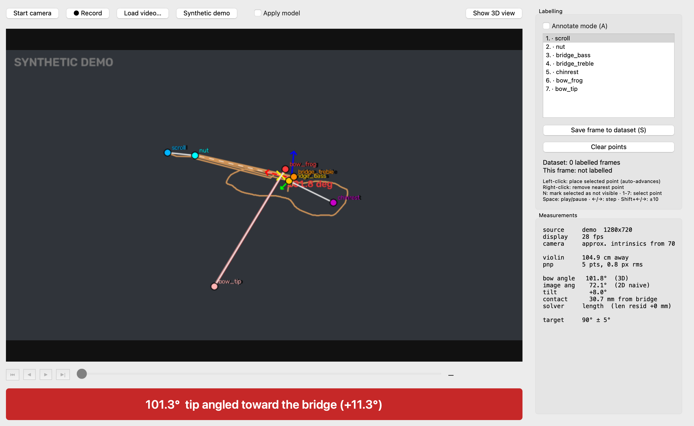
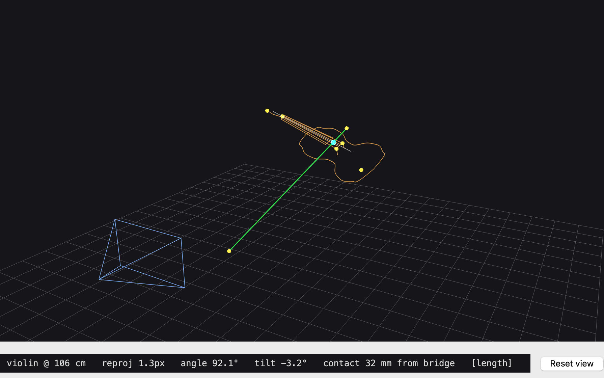
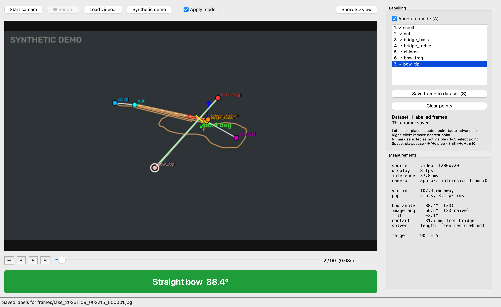
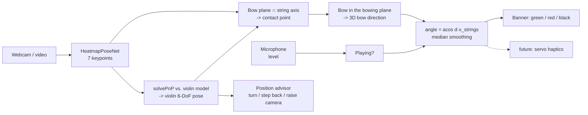

# bowtrack: real-time violin bow-angle coach

A computer-vision app that watches a violinist through a laptop webcam, finds the
violin and bow with a PyTorch keypoint network, recovers their **3D pose** from a
single camera, and measures the angle between the bow and the strings. A banner
turns **green** when the bow is straight (90° ± tolerance), **red** when it drifts
(and says which way), and **black** when no bow is visible.



| 3D view | Labelling tool |
|---|---|
|  |  |

## Why 3D?

The webcam sees the violin obliquely, so the angle *in the image* is badly
distorted. In the screenshot above the bow is 101.8° to the strings in 3D, but
only 72° in the image. bowtrack measures the true 3D angle.

## Pipeline



**Keypoints** (`src/bowtrack/keypoints.py`): 10 on the violin (`scroll, nut,
bridge_bass, bridge_treble, tailpiece_top, tailpiece_end`, and the four body
corners where the purfling points out at the C-bouts) plus `bow_frog, bow_tip`.
The tailpiece is used instead of the chin rest because it is centred on every violin.
The corners are spread across the body, so they fix the violin's tilt and roll,
which the 34 mm-wide bridge alone barely constrains. In simulation they cut the
face-direction error from about 5° to 1.5°.

**Model** (`src/bowtrack/model.py`): SimpleBaseline-style heatmap network with an
ImageNet-pretrained torchvision backbone (ResNet-50 teacher; ResNet-18 /
MobileNetV3 students). The peak of each heatmap is the keypoint and its height is
the confidence. A hidden keypoint is trained to an all-zero map.

**Geometry** (`src/bowtrack/geometry.py`):
1. *Violin pose*: the visible violin keypoints are matched to a 3D model of a
   4/4 violin (`configs/default.yaml`) with SQPnP and LM refinement. The previous
   frame's pose is used as a prior to resolve flips.
2. *Contact point*: the camera centre and the 2D bow line span a plane. Its
   intersection with the 3D string axis is where the bow crosses the strings,
   which also gives the **sounding-point distance from the bridge** in mm.
3. *Bow direction*. A sounding bow rests on a string, so it lies
   in that string's *bowing plane*. The bridge is arched, so each string has
   its own tilt (G +20°, D +7°, A −7°, E −20° about the string axis,
   `strings.tilt_deg`). Bowing plane ∩ interpretation plane gives the bow
   direction in closed form. This needs only the bow's 2D line (any
   visible piece of stick or hair), not the bow length or either end, so the
   bow can run out of frame. With 2 px label noise the median error is under 0.5°.

   Which string is played is **not** detected. The **String** box defaults to
   *Any*: the middle (D/A) plane is assumed, or, when both bow ends are in
   view, the bow length picks the tilt. How much the string could matter depends
   only on the viewpoint, and the position bar (below) keeps the player where it
   is under 5°. From a good viewpoint the four planes give almost the same
   angle. Picking a string by hand (open-string or one-string practice) makes it
   exact from any viewpoint.
   Keypoints that don't fit the model (reprojection > 4 px) are found by greedy
   leave-one-out and ignored: up to 2, always keeping at least 5 points.
4. *Angle*: `acos(d_bow · x_strings)`. Tilting the bow to cross strings is a
   rotation *about* the string axis, so it does not change this angle.

### Geometry accuracy (synthetic, 200 random poses, violin ~1 m from a 720p webcam)

| keypoint noise | median angle error | 90th percentile |
|---|---|---|
| 0.5 px | 0.57° | 1.48° |
| 1.5 px | 1.79° | 4.76° |
| 3.0 px | 3.22° | 8.96° |

Nearly all of the error comes from estimating the violin's pose, not the bow.
Getting the camera closer, calibrating it, and labelling precisely all help directly.

The geometry runs in about 1 ms per frame. `pytest` checks exact recovery across
angles and tilts, plus robustness to noise.

## Quickstart

```bash
python3 -m venv .venv && source .venv/bin/activate
pip install -e ".[dev]"
pytest                       # geometry + model unit tests
bowtrack --demo              # synthetic scene: banner + 3D view, no model needed
bowtrack --camera            # live webcam
```

On macOS, give your terminal camera access the first time
(System Settings → Privacy & Security → Camera).

## Workflow: from webcam to trained model

1. **Record**: `Start camera` → `● Record`. Play a few takes with good *and*
   bad bow angles, different lighting, and the whole bow in view. When you stop,
   the take opens for frame-by-frame review.
2. **Label**: tick *Annotate mode* (`A`). Each new frame starts on the first
   point it still needs (the scroll on a fresh frame). Click the points in order
   (the list auto-advances), drag any placed point to move it, `N` = not visible,
   right-click removes a point. The panel shows a diagram of where the selected
   point goes. Frames you label by hand count as **approved** and are saved to
   `data/annotations.json` (frames go to `data/frames/`). Edits are saved
   when you leave the frame, or with `S`. While you click, the fitted 3D violin
   is drawn over the frame, with a line from each click to the model's
   prediction, and the 3D window updates, so a bad click or wrong pose is
   obvious right away.
3. **Train**: `python scripts/train.py` (ResNet-50 by default, on MPS/CUDA).
   Only **approved** frames are used. With 6+ takes, whole takes are held out
   for validation. With fewer, the last 15% of each take's frames are. It
   reports pixel error, PCK, and visibility precision/recall.
4. **Let the model label, then check**: load a take and press *Label frames
   with model* (every N-th frame; frames already labelled are skipped). Its
   labels go to `data/model_labels.json` and the **To check** tab. Points under
   60% confidence, frames with no pose, and frames whose fit is off by more than
   4 px are flagged in orange. Click a frame, drag any wrong point into place,
   and press **✓ Approve** (`Enter`). The frame moves to *Approved* (training
   data) and the next frame to check opens. `[` / `]` step through the tab
   shown, and *Delete labels* drops a frame from either group. Retrain, repeat.
   Ticking *Apply model* also runs inference live and pre-fills new frames
   (those also stay "to check" until approved).
   On a recorded take, *Apply model* runs the model up to 90 frames ahead of the
   playhead, so playback runs at the take's frame rate with every frame's points
   ready, and stepping back is instant. Start the app with the model on with
   `python -m bowtrack.gui.app --video recordings/take_….mp4 --model --no-sound`.
   The **Tolerance ±** box in the toolbar sets the green band live (default
   `feedback.tolerance_deg`).
5. **Calibrate (optional, recommended)**:
   `python scripts/calibrate_camera.py --cols 9 --rows 6 --square-mm 25`.
   Without calibration, intrinsics are approximated from a 70° FOV.
   Also measure your violin and bow, and update `configs/default.yaml`.

GUI shortcuts: `Space` play/pause, `←/→` step a frame, `Shift+←/→` step 10,
`1-7` pick a keypoint.

## Fitting your violin and checking the pose (offline)

Standard dimensions are only approximate (corner positions in particular
vary), and a wrong 3D model biases every pose. Two offline tools fix and
check this. Neither runs in the live loop.

```bash
python scripts/fit_violin_model.py      # learn YOUR violin's 3D keypoints + camera focal length
python scripts/validate_pose.py --compare
```

* **Model fitting** (`model_fit.py`) is bundle adjustment over all labelled
  frames. It solves jointly for the violin's 3D keypoints (left/right symmetric,
  scale fixed by the string length), the focal length, and every frame's pose,
  with weak priors toward standard dimensions. It reports a ±1σ for each
  dimension, and anything poorly determined can be pinned with a ruler
  measurement in `violin_measurements` (`configs/default.yaml`). On the
  author's 17 frames it cut reprojection error from 11.9 px to 3.4 px, and
  fitting on one take then testing on the other took the held-out error from
  12 px to 5 px. The result goes to `configs/violin_fit.yaml`, which is loaded
  automatically.
* **Contour check** (`validation.py`) projects the body outline (standard bout
  widths, corners on the fitted keypoints) and measures its distance to
  *orientation-matched* image edges, so strings and clothing crossing the
  outline don't count. It is independent evidence, because the fit never sees
  image edges. `train.py` runs it before training and lists suspicious frames.

## Sound: is the bow on a string?

`src/bowtrack/audio.py` (pure numpy, tested) measures the level against a
tracked noise floor. While a note sounds, the bow must be on a string. During
silence the banner goes black instead of guessing. The pitch is not used.
Live audio comes from
the microphone through Qt Multimedia (`gui/mic.py`). While recording, it is
saved as `recordings/take_….wav` next to the video, so scrubbing and labelling
a take later use the same sound.

On macOS, allow microphone access for Terminal (the first start asks), the same
as for the camera.

## Position indicator: turn, step back, raise the camera

The bar under the bow banner (`src/bowtrack/positioning.py`) tells you how to
stand so the angle can be measured.

The key number is how much the bow angle would change if the wrong string's
bowing plane were assumed. From a good viewpoint the four planes give almost the
same angle. From a bad one they differ by 15° or more. For the current pose,
and for the player turning by ±60° (plus the camera raised by up to 40°), the
advisor computes that error for bows at 85/90/95°. It then suggests the smallest
change that brings the error under 5°. The limit is 10° when a single string
is chosen in the **String** box.

Messages, in priority order:

- **Step back**, or **move left/right**, when the violin is cut off by the frame.
- **Turn your body ~N° to your left/right.** Directions are from the player's
  point of view; the webcam image is not mirrored.
- **Raise the camera** to look down onto the top plate, when turning isn't enough.
  If the top plate is seen nearly edge-on, every string plane looks the same.
- **Step closer**, when the violin is too small (below 0.4 px per mm, about 2.3 m from a 720p webcam).

On the author's labelled frames, the first take (view 50–63°) got
"turn ~20–35° to your left" (±13–23° → ±4–5°). The second take got small
corrections or "position good".

The bow no longer has to stay fully in frame. Only the stretch near the strings
needs to be visible.

## Camera placement matters more than anything else

From one camera, the bow's lean along the strings is mixed up with depth:
two 3D bow directions usually produce the same image. How much that affects
the measured angle depends on the angle between the camera's line of sight
and the strings. Simulated at the author's real violin poses, with perfect
labels:

| camera line of sight vs strings | frames > 5° off |
|---|---|
| 39° (looking along the strings) | 49% |
| 63° (typical webcam in front of the player) | 22% |
| 77° (strings lying across the image) | 5% |

The GUI shows this as `view … to strings`. Turn so that the scroll and
tailpiece are about equally far from the camera, and keep the whole bow in
frame: a clipped tip removes the length constraint. The bow solver combines
the length and tilt constraints as one MAP estimate instead of switching
between methods, which removed jumps of up to 12° between near-identical frames.

## Related work

* Keypoints + PnP for 6-DoF object pose is a standard monocular approach:
  [PVNet (Peng et al., CVPR 2019)](https://arxiv.org/abs/1812.11788) predicts
  2D keypoints and solves an uncertainty-weighted PnP. See also this
  [survey of monocular object pose](https://arxiv.org/pdf/2105.14291).
* Violin bowing capture usually needs extra hardware: a Kinect depth camera
  with markers ([Vamvakousis et al., SMC 2018](https://repositori.upf.edu/items/1c9759b5-921c-4b68-a5e5-5380c084fe17)),
  depth + ICP against a 3D violin model ([Shiino et al., 2012](https://www.uni-muenster.de/PRIA/WDIA2012/scientific_program/Paper-Shiino.pdf)),
  or several cameras ([Audio Matters Too!, 2024](https://arxiv.org/pdf/2405.04963)).
  Single-camera work tends to use markers ([Kritsis, 2016](https://zenodo.org/records/1183505/files/MScThesisKosmasKritsis.pdf))
  or stops at 2D angles ([UPF thesis](https://recercat.cat/handle/10230/42386)).
  bowtrack's contribution is markerless single-webcam 3D, with the ambiguity
  measured rather than hidden.

## Project layout

```
src/bowtrack/
  camera.py       threaded webcam capture (Task 1)
  video.py        recorder + random-access video reader
  model.py        HeatmapPoseNet, letterbox, heatmap encode/decode
  detector.py     checkpoint loading + inference wrapper (Task 3)
  geometry.py     intrinsics, PnP, bow 3D solve, angle (Task 4)
  feedback.py     smoothed green/red/black state + FeedbackSink hook (Task 5)
  audio.py        sound level -> is a note sounding? (.wav I/O)
  positioning.py  "how to stand" advisor: turn / step back / raise camera
  overlay.py      OpenCV drawing
  annotations.py  JSON label stores (approved / model labels to check)
  dataset.py      augmented training dataset
  synthetic.py    ground-truth scenes for tests and demo mode
  gui/            PySide6 main window, pyqtgraph 3D window, Qt microphone (Tasks 2, 4, 5)
  model_fit.py    bundle adjustment of the violin model + focal length
  validation.py   offline outline-vs-edge pose check
scripts/          train.py, calibrate_camera.py, fit_violin_model.py, validate_pose.py
tests/            pytest suite
```

## Roadmap

- [ ] **Distillation + INT8 quantization**: distil the ResNet-50 FP32 teacher
      into a ResNet-18 / MobileNetV3 student (heatmap MSE to teacher outputs +
      ground truth). Then apply post-training INT8 quantization (torch.ao FX
      or ONNX Runtime) and benchmark accuracy against FPS. The head avoids
      transposed convs, so it fuses and quantizes cleanly.
- [ ] **Haptic feedback**: a microcontroller + servo that taps the arm. Implement
      `FeedbackSink.send()` (e.g. pyserial) and attach it to `BowFeedback.sinks`.
      The signed error already says which direction to correct.
- [ ] More bow keypoints (e.g. mid-stick) for when the tip leaves the frame.
