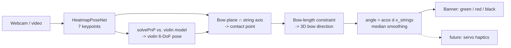

# bowtrack: real-time violin bow-angle coach

A computer-vision app that watches a violinist through a laptop webcam, finds the
violin and bow with a PyTorch keypoint network, recovers their **3D pose** from a
single camera, and measures the angle between the bow and the strings. A banner
turns **green** when the bow is straight (90° ± tolerance), **red** when it drifts
(and says which way), and **black** when no bow is visible.


| 3D view | Labelling tool |
|---|---|
|  |  |

## Why 3D?

The webcam sees the violin obliquely, so the angle *in the image* is badly
distorted. In the screenshot above the bow is 101.8° to the strings in 3D, but
only 72° in the image. bowtrack measures the true 3D angle.

## Pipeline



**Keypoints** (`src/bowtrack/keypoints.py`): `scroll, nut, bridge_bass,
bridge_treble, chinrest` (violin) and `bow_frog, bow_tip` (bow).

**Model** (`src/bowtrack/model.py`): SimpleBaseline-style heatmap network with an
ImageNet-pretrained torchvision backbone (ResNet-50 teacher; ResNet-18 /
MobileNetV3 students). The peak of each heatmap is the keypoint and its height is
the confidence. A hidden keypoint is trained to an all-zero map.

**Geometry** (`src/bowtrack/geometry.py`):
1. *Violin pose*: the visible violin keypoints are matched to a 3D model of a
   4/4 violin (`configs/default.yaml`) with SQPnP and LM refinement. The previous
   frame's pose is used as a prior to resolve flips.
2. *Contact point*: the camera centre and the 2D bow line span a plane. Its
   intersection with the 3D string axis is where the bow crosses the strings,
   which also gives the **sounding-point distance from the bridge** in mm.
3. *Bow direction*: inside that plane, the frog and tip must lie on their camera
   rays and be exactly one bow-hair length apart. This is solved by a vectorised
   scan plus Brent root-finding. Of the two mirror solutions, the one lying
   closest to the string plane wins. If noise leaves no solution, the bow is
   assumed to lie in the string plane.
4. *Angle*: `acos(d_bow · x_strings)`. Tilting the bow to cross strings is a
   rotation *about* the string axis, so it does not change this angle.

### Geometry accuracy (synthetic, 200 random poses)

| keypoint noise | median angle error | 90th percentile |
|---|---|---|
| 0.5 px | 0.19° | 0.66° |
| 1.5 px | 0.67° | 1.97° |
| 3.0 px | 1.20° | 3.94° |

The geometry runs in about 1 ms per frame. `pytest` checks exact recovery across
angles and tilts, plus robustness to noise.

## Quickstart

```bash
python3 -m venv .venv && source .venv/bin/activate
pip install -e ".[dev]"
pytest                       # geometry + model unit tests
bowtrack --demo              # synthetic scene: banner + 3D view, no model needed
bowtrack --camera            # live webcam
```

On macOS, give your terminal camera access the first time
(System Settings → Privacy & Security → Camera).

## Workflow: from webcam to trained model

1. **Record**: `Start camera` → `● Record`. Play a few takes with good *and*
   bad bow angles, different lighting, and the whole bow in view. When you stop,
   the take opens for frame-by-frame review.
2. **Label**: tick *Annotate mode* (`A`). Click the 7 points in order (the list
   auto-advances), `N` = not visible, right-click removes a point, and `S` saves.
   Labels go to `data/annotations.json` and frames to `data/frames/`. Spread
   ~150-300 labelled frames across takes, taking every 5-10th frame. Saved
   labels already drive the full 3D pipeline, so the geometry can be checked on
   your own footage before any training.
3. **Train**: `python scripts/train.py` (ResNet-50 by default, on MPS/CUDA).
   It splits train/val **by take** to avoid leakage between near-identical
   frames, then reports pixel error, PCK, and visibility precision/recall.
4. **Apply**: tick *Apply model*. Inference runs on a worker thread. Once a
   model exists, it pre-fills labels on new frames, so labelling speeds up.
5. **Calibrate (optional, recommended)**:
   `python scripts/calibrate_camera.py --cols 9 --rows 6 --square-mm 25`.
   Without calibration, intrinsics are approximated from a 70° FOV.
   Also measure your violin and bow, and update `configs/default.yaml`.

GUI shortcuts: `Space` play/pause, `←/→` step a frame, `Shift+←/→` step 10,
`1-7` pick a keypoint.

## Project layout

```
src/bowtrack/
  camera.py       threaded webcam capture (Task 1)
  video.py        recorder + random-access video reader
  model.py        HeatmapPoseNet, letterbox, heatmap encode/decode
  detector.py     checkpoint loading + inference wrapper (Task 3)
  geometry.py     intrinsics, PnP, bow 3D solve, angle (Task 4)
  feedback.py     smoothed green/red/black state + FeedbackSink hook (Task 5)
  overlay.py      OpenCV drawing
  annotations.py  JSON label store
  dataset.py      augmented training dataset
  synthetic.py    ground-truth scenes for tests and demo mode
  gui/            PySide6 main window + pyqtgraph 3D window (Tasks 2, 4, 5)
scripts/          train.py, calibrate_camera.py
tests/            pytest suite
```

## Roadmap

- [ ] **Distillation + INT8 quantization**: distil the ResNet-50 FP32 teacher
      into a ResNet-18 / MobileNetV3 student (heatmap MSE to teacher outputs +
      ground truth). Then apply post-training INT8 quantization (torch.ao FX
      or ONNX Runtime) and benchmark accuracy against FPS. The head avoids
      transposed convs, so it fuses and quantizes cleanly.
- [ ] **Haptic feedback**: a microcontroller + servo that taps the arm. Implement
      `FeedbackSink.send()` (e.g. pyserial) and attach it to `BowFeedback.sinks`.
      The signed error already says which direction to correct.
- [ ] More bow keypoints (e.g. mid-stick) for when the tip leaves the frame.
